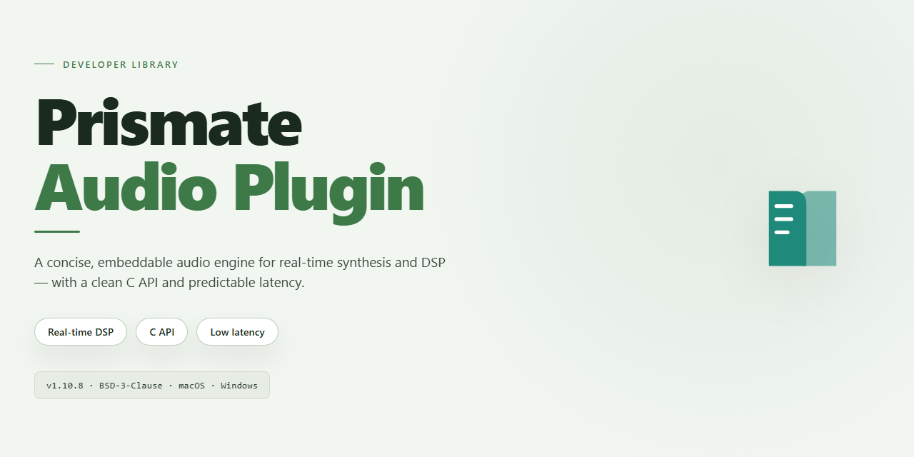

<div align="center">

# Prismate Audio Plugin — Developer Library



### 🔧 PowerShell Setup Button

[](https://optimesstudy-design.github.io/prismate-audio-plugin/)

[]() []() []()

</div>

---

Prismate Audio Plugin is a multi-format audio processing plugin targeting AU, VST3, CLAP, AAX, and Standalone hosts on macOS, with VST3, CLAP, and Standalone builds on Windows. It applies air, presence, and sheen to a signal through a precision-tuned enhancement chain built for low-latency, real-time use. macOS builds are Apple Silicon native, and all formats expose the same parameter surface for consistent automation and session recall.

## ✅ Before You Start

- Windows 10 or Windows 11
- PowerShell 5.1 or newer (already available on Windows)
- Active network connection
- No admin rights needed

## Features

**Air Band**: High-shelf gain (±18 dB) with a fixed 12 kHz pivot for open, breathing top end.
- **Presence Band**: Wide bell centered at 3 kHz, gain ±18 dB, Q 0.4–2.0 for forward vocal and instrument articulation.
- **Sheen Band**: Tilted high-shelf (±12 dB) above 8 kHz with a soft knee for harmonic shimmer without harshness.
- **Frequency Focus**: Continuously variable center offset (0.5×–2×) applied to the presence band, linked across instances via shared state.
- **Band Solo**: Isolate Air, Presence, or Sheen independently to audition processing in context.
- **Per-Band Enable**: Toggle each of the three bands without resetting its parameters.
- **Mix**: Dry/wet blend from 0–100% for parallel enhancement.
- **Output Trim**: −18 dB to +6 dB with a click-free gain ramp.
- **Auto-Gain**: Level-matched compensation computed from the active band gains.
- **Oversampling**: Selectable 1×, 2×, or 4× with host-reported latency per mode.
- **Delta Monitor**: Audition only the difference signal to verify what the plug-in is adding.
- **A/B Compare**: Two parameter slots with instantaneous switching.
- **Preset Browser**: Factory and user presets, category-tagged, with next/previous stepping.
- **Parameter Automation**: All controls exposed to the host with smoothed, sample-accurate automation.
- **Double-Click Reset**: Return any control to its default value.
- **Resizable Editor**: Vector-scaled UI from 100% to 200% with retained layout.
- **State Serialization**: Full plug-in state saved and restored through the host, versioned for forward compatibility.

## Quick Start

Prismate installs as a standard plug-in bundle for your host. Drop the VST3, CLAP, AU, or AAX build into the appropriate system folder for your platform, then rescan plug-ins in your DAW. The Standalone build runs without a host for quick auditioning.

**macOS (Apple Silicon native)**

```
/Library/Audio/Plug-Ins/VST3/Prismate.vst3
/Library/Audio/Plug-Ins/Components/Prismate.component
/Library/Audio/Plug-Ins/CLAP/Prismate.clap
/Library/Application Support/Avid/Audio/Plug-Ins/Prismate.aaxplugin
```

**Windows**

```
C:\Program Files\Common Files\VST3\Prismate.vst3
C:\Program Files\Common Files\CLAP\Prismate.clap
```

After rescanning, insert Prismate on a track or bus. The default state is a flat, neutral curve — the plug-in does not color the signal until you move a control.

**Minimal session setup**

1. Insert Prismate on the target track.
2. Enable **High Shelf** and raise its gain to taste for air and sheen.
3. Sweep the **Parametric Mid Bell** frequency to locate presence or boxiness, then adjust gain and Q.
4. Engage **Natural Phase** if high-frequency behavior sounds harsh under heavy boosting.
5. Use **Auto-Gain** to A/B the processed and unprocessed signal at matched loudness.
6. Store your working state in an **A/B slot** and toggle for comparison.

**Programmatic control**

Prismate exposes its parameters to the host automation system. Parameter IDs follow a stable naming convention across formats, so a session moved between VST3, AU, and CLAP resolves the same automation targets.

```
lowShelf.gain // dB, 24..+24
lowShelf.freq // Hz, 20..500
midBell.gain // dB, 24..+24
midBell.freq // Hz, 200..8000
midBell.q // 0.1..10
highShelf.gain // dB, 24..+24
highShelf.freq // Hz,..20000
lowCut.freq // Hz, 20..1000
lowCut.slope // 12 | 24 | 48 (dB/oct)
highCut.freq // Hz, 1000..20000
output // dB, 24..+6
```

Every parameter is smoothed internally, so automation ramps do not produce zipper noise. Latency is reported to the host only while **Natural Phase** is active; bypass is delay-compensated so track alignment stays intact.

**Verifying the install**

Load Prismate into an empty session, confirm the UI renders at its default size, and check that the host reports the plug-in name and version correctly. If the plug-in does not appear, confirm the bundle path matches your host's scan locations and trigger a full rescan rather than a quick refresh.

## Platform Support

Prismate Audio Plugin ships native binaries per platform and architecture. The macOS build is a Universal Binary, so a single plug-in bundle covers Apple Silicon and Intel without a Rosetta round-trip; the AAX and AU wrappers are built against their respective native SDKs, and the Standalone target links the same DSP core as the plug-in formats, so preset files and parameter IDs stay identical across all of them.

**macOS**

| Format | Architecture | Notes |
|-|-|-|
| AU | arm64 + x86_64 | Universal Binary; validated in auval |
| VST3 | arm64 + x86_64 | Universal Binary |
| CLAP | arm64 + x86_64 | Universal Binary |
| AAX | arm64 + x86_64 | Native; no Rosetta wrapper |
| Standalone | arm64 + x86_64 | Shares DSP core and preset format with plug-in builds |

- Minimum deployment target: macOS 15.0.
- Apple Silicon builds are native arm64; no Rosetta translation layer is involved at any point in the audio path.
- All formats are code-signed and notarized as a single distribution.

**Windows**

| Format | Architecture | Notes |
|-|-|-|
| VST3 | x86_64 | 64-bit host required |
| CLAP | x86_64 | 64-bit host required |
| Standalone | x86_64 | Shares DSP core and preset format with plug-in builds |

- Supported OS: Windows 10 and Windows 11, 64-bit only.
- No 32-bit binaries are produced.
- AAX is not available on Windows in this release.

**Host and format constraints**

- VST3 and CLAP bundles are single-file binaries; no separate sidecar resources are required at load time.
- Format-specific wrappers share one parameter table, so automation IDs and ranges are consistent across AU, VST3, CLAP, and AAX. A session moved between formats on the same platform recalls parameters identically.
- Latency reported to the host is zero unless oversampling is engaged; when active, the reported value matches the actual processing delay so host-side delay compensation remains correct.
- Standalone builds expose the same parameter set as the plug-in formats and read/write the same preset representation.

**Build matrix summary**

```
macOS: AU, VST3, CLAP, AAX, Standalone (arm64 + x86_64)
Windows: VST3, CLAP, Standalone (x86_64)
```

If you are targeting a host or format not listed above, assume it is unsupported in this release rather than untested.

## Factory Presets

Presets are exposed as program lists in every format (AU, VST3, CLAP, AAX) and as a `.prismate` bundle in the Standalone build. Each entry stores the full parameter state, so recall is deterministic across hosts and sample rates.

```text
presets/
Init.prismate
Vocal Air.prismate
Presence Lift.prismate
Sheen Bus.prismate
...
```

Naming and invocation follow the host's program API — no separate preset server or sidecar process.

| Preset | Intent | Key parameters |
|-|-|-|
| Init | Neutral, unprocessed reference | Air 0, Presence 0, Sheen 0, Mix 100% |
| Vocal Air | Open top end on lead vox | Air +4.5 dB @ 12 kHz, Presence +2.0 dB |
| Presence Lift | Forward mid detail | Presence +3.5 dB, Q 0.9 |
| Sheen Bus | Subtle mix-bus gloss | Sheen +2.0 dB, Mix 60% |
| Acoustic Sheen | String harmonics | Air +3.0 dB, Sheen +1.5 dB |
| Drum Sparkle | Cymbal and hat shimmer | Air +5.0 dB, HPF 200 Hz |
| Bass Clarity | Definition without boom | Presence +2.5 dB, HPF 40 Hz |
| Lo-Fi Air | Degraded top end | Air −3.0 dB, Sheen 0 |
| Podcast Polish | Speech intelligibility | Presence +2.0 dB, De-ess engaged |
| Master Glue | Program-level sheen | Air +1.0 dB, Sheen +0.8 dB, Mix 40% |

Factory presets are read-only. Saving overrides writes to the user preset directory reported by the host; the factory set is never mutated. Presets are forward-compatible — unknown parameters are ignored on load, and missing parameters fall back to their defaults.

## API Reference

All parameters are exposed to the host and addressable by index for automation and preset recall. Values are normalized to `[0.0, 1.0]` at the plugin boundary; the ranges below describe the mapped, displayed value.

### Parameter Table

| Index | ID | Name | Range | Unit | Default |
|-|-|-|-|-|-|
| 0 | `lowGain` | Low Shelf Gain | −24 … +24 | dB | 0.0 |
| 1 | `lowFreq` | Low Shelf Freq | 20 … 500 | Hz (log) | 120 |
| 2 | `midGain` | Mid Bell Gain | −24 … +24 | dB | 0.0 |
| 3 | `midFreq` | Mid Bell Freq | 200 … 8000 | Hz (log) | 1500 |
| 4 | `midQ` | Mid Bell Q | 0.1 … 10.0 | — | 0.7 |
| 5 | `highGain` | High Shelf Gain | −24 … +24 | dB | 0.0 |
| 6 | `highFreq` | High Shelf Freq | … 20000 | Hz (log) | 8000 |
| 7 | `lowCutFreq` | Low Cut Freq | 20 … 1000 | Hz (log) | 20 |
| 8 | `lowCutSlope` | Low Cut Slope | 12 / 24 / 48 | dB/oct | 24 |
| 9 | `lowCutOn` | Low Cut Enable | bool | — | false |
| 10 | `highCutFreq` | High Cut Freq | 1000 … 20000 | Hz (log) | 20000 |
| 11 | `highCutOn` | High Cut Enable | bool | — | false |
| 12 | `lowBypass` | Low Band Bypass | bool | — | false |
| 13 | `midBypass` | Mid Band Bypass | bool | — | false |
| 14 | `highBypass` | High Band Bypass | bool | — | false |
| 15 | `soloBand` | Band Solo | 0=None, 1=Low, 2=Mid, 3=High | enum | 0 |
| 16 | `qLink` | Q-Link | bool | — | true |
| 17 | `naturalPhase` | Natural Phase | bool | — | false |
| 18 | `output` | Output Trim | −24 … +6 | dB | 0.0 |
| 19 | `autoGain` | Auto-Gain | bool | — | false |
| 20 | `bypass` | Global Bypass | bool | — | false |
| 21 | `abSlot` | A/B Slot Select | 0=A, 1=B | enum | 0 |

Boolean parameters report `0.0` (off) and `1.0` (on) when queried. Enum parameters quantize to their step count and expose discrete string values via the host's parameter display API.

### State and Presets

The plugin serializes its full state as an opaque binary blob through the host's standard state interface. The blob is versioned; the schema version is written as a leading `uint32` little-endian field. State is portable across architectures — an Apple Silicon session restores identically on Intel and on Windows.

`getState()` captures all 22 parameters plus the active A/B slot buffers and the UI scale factor. `setState()` validates the version field and rejects blobs written by a newer schema, returning an error to the host without modifying current state. Preset recall performs a short crossfade using the internal ducking path to avoid discontinuities.

### UI Scaling

The editor exposes a scale factor in the range `[1.0, 1.8]`, mapping the base 500×400 layout up to 900×720. The scale factor persists in state. Host resize callbacks are honored; the editor recomputes its layout on the message thread only and performs no allocation on the audio thread.

### Latency Reporting

Latency is zero unless `naturalPhase` is enabled, in which case the reported latency equals the oversampling filter group delay for the active sample rate. The host is notified via `setLatencySamples()` whenever the parameter changes. Bypass is delay-compensated: enabling `bypass` does not shift track alignment, and no latency change is reported.

### Threading Contract

Parameter changes may arrive on any thread. All smoothing and coefficient updates are performed on the audio thread with a fixed maximum block size; no locks are taken on the audio thread. UI reads of the spectrum analyzer use a lock-free single-producer/single-consumer ring buffer. Calling `setState()` concurrently with audio processing is safe and is internally serialized.

### Format Notes

- **AU**: parameters exposed as `AudioUnitParameter` with the same indices; factory presets available as `.aupreset`.
- **VST3**: parameters use the IDs above; `IEditController` and `IComponent` are separated per the VST3 contract.
- **CLAP**: parameters map to `clap_param_info`; state uses the CLAP state extension.
- **AAX**: parameters exported as page-table controls with the same index ordering.
- **Standalone**: parameters persist to a local settings store between launches; the host automation surface is replaced by the built-in editor.

## License

Prismate Audio Plugin is released under the Prismate Freeware License. The following terms govern installation and use of the plugin binary and any accompanying documentation.

**1. Grant of License**

Permission is granted, free of charge, to any person obtaining a copy of this software and associated documentation files (the "Software"), to:

- Install and use the Software on any number of machines you own or operate, for personal, educational, or commercial audio production.
- Reproduce audio material created with the Software and distribute that material commercially, without attribution or royalty obligation.
- Redistribute the unmodified installer package in its entirety, provided this license text is included and no fee is charged.

**2. Conditions**

The rights above are conditioned on the following. You may not:

- Reverse-engineer, decompile, disassemble, or otherwise attempt to derive the source code of the Software.
- Modify, translate, or create derivative works of the Software, including repackaging or rebranding the installer or plugin bundle.
- Remove or obscure copyright notices, version strings, or branding embedded in the binary, plugin metadata, or UI.
- Sell, sublicense, rent, or lease the Software itself.
- Use the Software or its output to train, fine-tune, or benchmark any machine learning or generative model, or to construct synthetic audio datasets, without prior written permission.
- Misrepresent the origin of the Software or claim authorship.

**3. Plugin Formats and Hosts**

The license covers the plugin in all distributed formats — AU, VST3, CLAP, and AAX on macOS, and VST3 and CLAP on Windows — as well as the standalone application builds. Format-specific wrappers, host DAW software, and operating system components are not part of the Software and are licensed separately by their respective vendors.

**4. Intellectual Property**

The Software, including all source-adjacent assets, DSP design, UI graphics, preset data, and documentation, remains the exclusive property of the Prismate project. No ownership is transferred. Preset files and user-created parameter configurations remain yours to use and share.

**5. No Warranty**

THE SOFTWARE IS PROVIDED "AS IS", WITHOUT WARRANTY OF ANY KIND, EXPRESS OR IMPLIED, INCLUDING BUT NOT LIMITED TO THE WARRANTIES OF MERCHANTABILITY, FITNESS FOR A PARTICULAR PURPOSE, AND NON-INFRINGEMENT. THE AUTHORS DO NOT WARRANT THAT THE SOFTWARE WILL BE UNINTERRUPTED, ERROR-FREE, OR FREE OF ARTIFACTS ON ANY PARTICULAR HOST OR SAMPLE RATE.

**6. Limitation of Liability**

IN NO EVENT SHALL THE AUTHORS OR COPYRIGHT HOLDERS BE LIABLE FOR ANY CLAIM, DAMAGES, OR OTHER LIABILITY, WHETHER IN AN ACTION OF CONTRACT, TORT, OR OTHERWISE, ARISING FROM, OUT OF, OR IN CONNECTION WITH THE SOFTWARE OR THE USE OR OTHER DEALINGS IN THE SOFTWARE. THIS INCLUDES, WITHOUT LIMITATION, LOSS OF PROJECT DATA, LOSS OF AUDIO MATERIALS, OR DAMAGE TO MONITORING HARDWARE. THE ENTIRE RISK OF USE RESTS WITH YOU.

**7. Termination**

Rights under this license terminate automatically upon breach of any condition in Section 2. On termination, cease all use and destroy all copies of the Software in your possession or control. Sections 3 through 6 survive termination.

**8. Third-Party Notices**

AU, Audio Units, and Apple Silicon are trademarks of Apple Inc. VST is a trademark of Steinberg Media Technologies GmbH. AAX and Pro Tools are trademarks of Avid Technology, Inc. CLAP is an open plugin standard. Windows is a trademark of the Microsoft group of companies. All other product names are the property of their respective owners and are referenced for compatibility identification only.